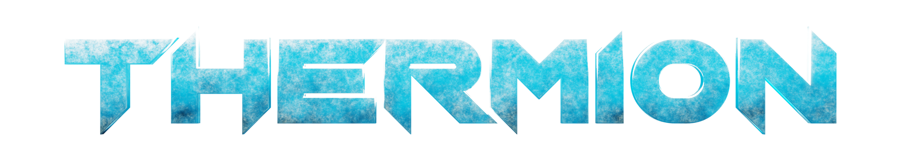

<p align="center">
  <a href="https://thermion.dev/quickstart">Quickstart (Flutter)</a> •
  <a href="https://thermion.dev/">Documentation</a> •
  <a href="https://discord.gg/h2VdDK3EAQ">Discord</a>
</p>

## Cross-platform 3D toolkit for Dart and Flutter.

<a href="https://pub.dev/packages/thermion_dart"></a>
<a href="https://github.com/nmfisher/thermion"></a>
<a href="https://discord.gg/h2VdDK3EAQ"></a>
<a href="https://github.com/nmfisher/thermion"></a>

[](https://youtu.be/qV82gcMJKjY)

### Features

- Supports iOS (arm64), MacOS (arm64/x64), Android (arm64), Windows (x64) (>= 10), Web/WASM 
- glTF, KTX, PNG & JPEG texture support
- camera/entity manipulation with mouse (desktop) and gestures (mobile)
- skinning + morph animations

Uses the Filament PBR engine.

### Filament version and custom materials

Use `filamentVersion` to select the matching Filament release when compiling
custom materials with `matc`:

```dart
import 'package:thermion_dart/filament_version.dart';

void main() {
  print(filamentVersion); // v1.77.2
}
```

It is also exported by `package:thermion_dart/thermion_dart.dart`. The constant
works with hosted, Git and path dependencies, and is the version used by the
native build hook. Recompile your custom materials when it changes.

After initializing Filament, `FilamentApp.instance!.materialVersion` gives the
material format number reported by `matc --version`. This number is distinct
from the Filament release version. Compile custom materials with `matc` from
the same Filament release as the application.

`createMaterial` rejects incompatible format versions and malformed chunk
layouts with a Dart `FormatException` before calling Filament's material
builder. It does not validate every payload or backend requirement; other
invalid packages can still cause a native panic.

#### Runtime material compilation (optional)

Runtime packages use Filament's performance optimization (`matc`'s default,
or `-O`), rather than the size optimization selected by `matc -S`. They are
not promised to be byte-identical to offline packages. Both runtime APIs
embed the compilation flags and their input source for inspection; full
packages embed the source after in-memory includes have been resolved.
The web runtime compiler targets WebGL (`OPENGL`); it does not generate
WebGPU materials.

Instead of precompiling `.filamat` packages with `matc`, apps that need to
generate materials at runtime (e.g. user-authored or procedurally generated
shaders) can compile GLSL material source directly on the device:

```dart
final material = await FilamentApp.instance!.compileMaterialSource(
  'my_material',
  '''
  void material(inout MaterialInputs material) {
    prepareMaterial(material);
    material.baseColor.rgb = float3(1.0, 0.0, 0.0);
  }
  ''',
  shading: MaterialShading.lit,
);
```

For full `.mat` sources — the same format the `matc` tool accepts, with a
`material { ... }` configuration block (parameters, shading model, variants,
...) and `#include` directives — use `compileMaterialPackage`. Includes are
resolved from an in-memory map (exact-name match, no filesystem access):

```dart
final material = await FilamentApp.instance!.compileMaterialPackage(
  'my_material',
  '''
  material {
      name : "MyMaterial",
      shadingModel : unlit,
      parameters : [ { type : float4, name : baseColor } ]
  }
  fragment {
      #include "common.glsl"
      void material(inout MaterialInputs material) {
          prepareMaterial(material);
          material.baseColor = tint(materialParams.baseColor);
      }
  }
  ''',
  includes: {
    'common.glsl': 'vec4 tint(vec4 c) { return c * vec4(1.0, 0.9, 0.8, 1.0); }',
  },
);
```

Both APIs require linking `libfilamat` — Filament's offline material compiler,
which bakes in glslang and SPIRV-Tools — plus `libmatp` (the `.mat` parser
behind `matc`) for `compileMaterialPackage`, so they are opt-in. Add the flag
to your app's `pubspec.yaml`:

```yaml
hooks:
  user_defines:
    thermion_dart:
      runtime_materials: true
```

The flag adds roughly 8–45 MB to the native library depending on platform and
build mode (release `libfilamat.a` is ~45 MB; less is carried into the final
binary). `FilamentApp.instance!.runtimeMaterialsSupported` reports whether the
loaded build has it; `compileMaterialSource` and `compileMaterialPackage`
throw `UnsupportedError` otherwise. On web, the flag additionally selects a **filamat-enabled engine
variant** — the build hook fetches `thermion_dart-<sha>-web-runtime-materials.zip`
instead of the default wasm (~20 MB larger; it links `libfilamat`, the default
build dead-code-eliminates it). Compilation
is synchronous and CPU-intensive (hundreds of milliseconds) — run it before
startup or from a background isolate.

A live web demo — a GLSL editor that compiles and applies materials in the
browser — is in `examples/dart/material_editor`.

#### Compile-time feature opt-outs

By default every native build of `libthermion_dart` contains the glTF loader
(and its animation stack, Draco and the ubershader materials), the KTX/Basis
texture decoders and the PNG/JPEG decoder. An app that only draws procedural
geometry can switch them off under `hooks.user_defines.thermion_dart.features`
in its `pubspec.yaml` (all on by default; absent key = enabled):

```yaml
hooks:
  user_defines:
    thermion_dart:
      features:
        gltf: false            # no glTF loading/animation, no ubershader materials
        ktx: false             # no KTX1/KTX2 (incl. Basis) textures
        image_decoding: false  # no PNG/JPEG decoding
```

Each disabled feature removes its Filament archives from the link line
(measured on the stripped Linux x64 release `libthermion_dart.so`:
`gltf: false` alone takes it from 7.84 MB to 6.81 MB, all three off to
5.69 MB), while the C entry points stay exported as no-op stubs so the Dart
FFI bindings are the same in every variant.
`FilamentApp.instance!.supports(ThermionFeature.gltf)` (and `.ktx`,
`.imageDecoding`, `.runtimeMaterials`) reports what the loaded build has;
APIs that need a disabled feature throw an `UnsupportedError` naming the key
instead of failing deeper in the FFI layer:

| Disabled | Throws `UnsupportedError` | Keeps working |
| --- | --- | --- |
| `gltf` | `loadGltfFromBuffer`, `ThermionViewer.loadGltf*`, `ThermionViewerWidget.assetPath`, `createUbershaderMaterialInstance`/`createUbershaderMaterial`, glTF clip and bone animation, `getBones`/`releaseSourceData`, `parseGltf` (its cgltf parser ships inside gltfio, so it is compiled out with the rest of gltf) | `createGeometry`, instancing, custom morph animation (`AnimationManager.setMorphAnimation`/`clearMorphAnimation` — the entity-keyed morph buffer is gltfio-free; the asset-level `setMorphAnimationData` matches morph targets by their glTF names, so it needs `gltf: true`), and `createUnlitMaterialInstance` — the latter from a small **precompiled unlit material** the build hook compiles only for `gltf: false` builds (`hook/materials/unlit_fallback.mat`; same semantics as the ubershader's unlit variant: opaque white until `baseColorFactor` is set, vertex colours ignored). `createGeometry` without `materialInstances` never needed either: it renders with Filament's default material |
| `ktx` | `loadKtx2`, `loadKtx`/`createIblFromKtx` | `createImage`, `Texture.setLinearImage`/`loadImage` |
| `image_decoding` | `decodeImage` | `createImage`, `Texture.setLinearImage`/`loadImage` |

`gltf: true` together with `ktx: false` or `image_decoding: false` is
rejected by the build hook: Filament's resource loader has no defined
completion semantics without its texture decoders. Disable `gltf` as well.
Unknown keys under `features` warn; non-boolean values are build errors.
Web engines are prebuilt with every feature, so `features.*` only affects
native builds (the hook logs a warning on web).

#### Optional helper materials

The default viewer loads glTF assets, renders them with their authored materials,
and displays skyboxes and solid backgrounds with zero embedded helper packages.
For each feature your app uses, set its material key to `true` under
`hooks.user_defines.thermion_dart.materials` in the root pubspec.

| Feature | Material keys |
| --- | --- |
| Textured quads and background images | `image` |
| Grid, transform gizmo, translation axis, skeleton overlay | `grid`, `gizmo`, `translation_axis`, `bone_overlay`, respectively |
| Selection highlights | Both `silhouette` and `edge_outline` |
| Wireframes, world-space normal colors, selected triangle edges | `wireframe`, `normal_color`, `sharp_edge`, respectively |
| Embedded packages for UV capture, linear depth, fixed-size unlit geometry | `capture_uv`, `linear_depth`, `unlit_fixed_size`, respectively |

For example, an app using the sharp-edge view needs one entry:

```yaml
hooks:
  user_defines:
    thermion_dart:
      materials:
        sharp_edge: true
```

For a triangle with corners A, B, C, mask values 1, 2, and 4 select edges BC,
CA, and AB respectively. Combine them with bitwise OR. This example draws only AB.
The existing geometry helper supplies the barycentric coordinates in the first
three components of `attribute0`. Write the same mask into the fourth component
at each corner before uploading the geometry.

```dart
final geometry = GeometryUtils.duplicateVerticesWithBarycentrics(
  Float32List.fromList([-1, -1, 0, 1, -1, 0, 0, 1, 0]), // A, B, C
  [0, 1, 2],
);
for (var corner = 0; corner < 3; corner++) {
  geometry.attribute0[4 * corner + 3] = 4; // AB
}
final material = await app.createBuiltInMaterial(BuiltInMaterial.sharpEdge);
final instance = await material.createInstance();
final asset = await viewer.createGeometry(geometry, materialInstances: [instance]);
await viewer.addToScene(asset);
```

The caller owns the material and its instances. Remove their renderables, destroy
the instances, then destroy the material. Requesting a helper omitted from the
engine raises a `StateError` that names its pubspec key.

The build hook compiles only the enabled helper shaders from source
(`thermion_dart/hook/materials/*.mat`) using the version-matched, cached
Filament tools (`matc` / `resgen`). Compiled packages are cached per material
under `thermion_dart/.dart_tool/thermion_dart/materials/` so repeat builds,
`flutter clean`, and config changes skip recompilation. On native builds, the
hook links the compiled `.c` files for the selected graphics backend into
`libthermion_dart`. On Flutter web builds (`flutter run -d chrome`,
`flutter build web`), it embeds the enabled packages in `web/thermion_dart.wasm`.
Filament creates each material on first use.

For a Flutter app inside a pub workspace, set `web_directory: apps/viewer/web`
alongside `materials` under `hooks.user_defines.thermion_dart` in the workspace
pubspec. The path is relative to that pubspec.

For plain Dart web apps (`dart compile js` / `dart compile wasm`), pass
`--materials` to `thermion_dart:download_web` to fetch the slim engine and
embed the requested materials in the app’s copy of `thermion_dart.wasm`:

```sh
dart run thermion_dart:download_web -o web --materials grid,wireframe,gizmo
```

Pass each required key explicitly. Omit `--materials` for an app that uses no helpers.

### Quickstart (Flutter)

From the command line:

```bash
flutter channel stable
flutter upgrade
flutter config --enable-native-assets  
```

In your Flutter app:

```dart
@override
  Widget build(BuildContext context) {
    return Scaffold(
        body: Stack(children: [
        Positioned.fill(
            child: ViewerWidget(
          assetPath: "assets/cube.glb",
          skyboxPath: "assets/default_env_skybox.ktx",
          iblPath: "assets/default_env_ibl.ktx",
          transformToUnitCube: true,
          initialCameraPosition: Vector3(0, 0, 6),
          background: Colors.blue,
          manipulatorType: ManipulatorType.ORBIT,
          onViewerAvailable: (viewer) async {
            await Future.delayed(const Duration(seconds: 5));
            await viewer.removeSkybox();
          },
          initial: Container(
            color: Colors.red,
          ),
        ))]));
  }
```

> the first time you build an app that consumes this package, the Dart native-assets build system will download static binaries from Cloudflare. This may take a few minutes (depending on which platform you are compiling for). These will be cached, so subsequent builds will be much faster.

### Web

Web builds need two files (`thermion_dart.js` and `thermion_dart.wasm`) sitting alongside your app's `web/index.html`. In the normal case, `thermion_dart`'s build hook fetches them for you on `flutter run`/`flutter build web` — no extra step required:

```bash
flutter build web
```

The hook reads `native/web/web.version`, downloads the matching artifacts from Cloudflare R2, caches them under `.dart_tool/thermion_dart/web/<sha>/`, and copies them into your app's `web/` directory. Subsequent builds are instant unless the version changes.

If you want to fetch them ahead of time (e.g. for an offline build), you can do so manually:

```bash
dart run thermion_dart:download_web            # → ./web/
dart run thermion_dart:download_web -o custom  # → custom/
```

#### Iterating on native C++ against web

If you're modifying `thermion_dart`'s native code and want to test on web without bumping `native/web/web.version` and waiting for CI to rebuild the R2 artifacts, build the emscripten target locally and opt in via your app's `pubspec.yaml`:

```yaml
hooks:
  user_defines:
    thermion_dart:
      web_local: true
```

```bash
# Build the wasm (from native/web/build):
emcmake cmake ..
emmake make

# Then run/build your Flutter app:
flutter run -d chrome
```

When set, the build hook copies `thermion_dart.{js,wasm}` from `thermion_dart/native/web/build/build/out/` into your app's `web/` directory instead of downloading from R2. Remove the flag (or set it to `false`) to go back to the pinned prebuilt.

#### Main-thread rendering for standalone web clients

Custom browser clients can build the web engine with
`-DTHERMION_WEB_MAIN_THREAD=ON` (default: `OFF`). Initialize the engine and
call Thermion from the browser's main thread. Commands and completion
callbacks execute on that calling thread. Thermion does not create its own
render worker or transfer the canvas to one.

Serialize calls on that thread. Drive frames by calling `FilamentApp.render()`
from the application's animation loop. Command dispatch also drains pending
Filament commands and upload-release callbacks without requiring a frame.
Asynchronous glTF loading yields between progress polls so decoder tasks and
browser events can run.

The default build continues rendering through its worker loop. In that
build, `FilamentApp.render()` runs Dart's request-frame hooks but does not
request or await a rendered frame.

The main-thread option does not disable Emscripten pthread support or
Filament's internal helpers. Enabling it requires rebuilding the Wasm engine.
A Dart define or an existing worker bundle cannot enable it. No performance
improvement is implied by the option.

CI publishes the main-thread engine alongside the default one: the build hook
fetches it automatically when you set `web_variant` under
`hooks.user_defines.thermion_dart` in your app's `pubspec.yaml` — no local
toolchain needed:

```yaml
hooks:
  user_defines:
    thermion_dart:
      web_variant: main_thread
```

Unknown values log a warning and fall back to the default engine.
`web_local: true` composes with this: it then copies from
`native/web/build-main-thread/build/out/` (build that variant locally with
`emcmake cmake .. -DTHERMION_WEB_MAIN_THREAD=ON` into a separate directory).

#### Runtime-materials web engine

`runtime_materials: true` (the same user define that enables runtime material
compilation on native) also selects a web engine variant with `libfilamat`
linked — `compileMaterialSource` then works in the browser. The build hook
fetches `thermion_dart-<sha>-web-runtime-materials.zip` (~20 MB larger than
the default engine; the default dead-code-eliminates filamat). It composes
with `web_variant` and `web_local` like any other variant. See the live
editor demo in `examples/dart/material_editor`.
Once this lands, a matching `thermion_dart-<sha>-web-main-thread.zip` appears
on R2 only after the next native-changed push to `develop` bumps
`web.version` — until then main-thread consumers must keep building locally.

#### Running the test suite on web

The package:test suite runs on Chrome via a wrapper. Do not invoke `dart test -p chrome` directly — the multithreaded WASM build needs `crossOriginIsolated` (a COOP/COEP proxy), and each test file needs an HTML host that loads `thermion_dart.js` and the `thermion_canvas`. The wrapper handles both:

```bash
# from thermion_dart/
dart run tool/web_test_runner.dart --assets=../examples/assets test/texture_tests.dart
```

It stamps per-file `test/<name>.html`, starts `tool/coi_proxy.dart` on port 8899 (injecting the isolation headers and bridging `thermion.assets` / `thermion.output` sentinel hosts for asset reads and capture writes), runs `dart test -p chrome`, and prints a per-file summary.

Flags: `--port=N`, `--timeout=DUR`, `--concurrency=N`, `--assets=DIR`, `--no-proxy` (reuse an external proxy), `--clean` (delete the generated HTML on exit). With no test file arguments, it runs every `test/*_test.dart` and `test/*_tests.dart`.

`test/thermion_dart.{js,wasm}` are gitignored symlinks into `native/web/build/build/out/`, so they stay current after every `make wasm`.

### Sponsors, Contributors & Acknowledgments

Thermion uses the [Filament](https://github.com/google/filament) Physically Based Rendering engine under the hood.

Special thanks to [odd-io](https://github.com/odd-io/) for sponsoring work on supporting Windows, raycasting, testing and documentation.

Thank you to the following people:

- [@Hannnes1](https://github.com/Hannnes1) for help migrating to `native-assets`
- [@jarrodcolburn](https://github.com/jarrodcolburn) for documentation contributions
- [@daverin](https://github.com/daverin) for MacOS library contributions
- [@LukasPoque](https://github.com/LukasPoque) for CI/refactoring work
- [@alexmercerind](https://github.com/alexmercerind) for his work on integrating ANGLE textures on Flutter Windows
- [@BrutalCoding](https://github.com/BrutalCoding) for documentation fixes
- [@chenriji](https://github.com/chenriji) for testing and bug fixes
- [@JesperBellenbaum](https://github.com/JesperBellenbaum) for Vulkan/Windows improvements
- [@repentsinner](https://github.com/repentsinner) for Linux/EGL/Windows stability + improvements
- [@mwahnish](https://github.com/mwahnish) for bug fixes and web improvements
- [@aenriqu](https://github.com/aenriqu) for bone animation fixes 
- [@mushogenshin](https://github.com/mushogenshin) for Android & Windows swapchain & backend fixes
- [@arthur-lfn](https://github.com/arthur-lfn) for Linux/Vulkan fixes
- [@wperchinumio](https://github.com/wperchinumio) for detailed bug reports on memory leaks and missing features
